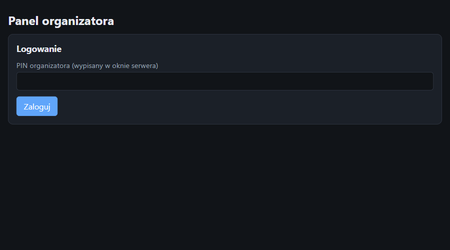
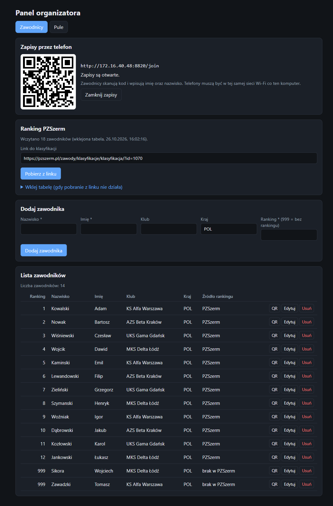
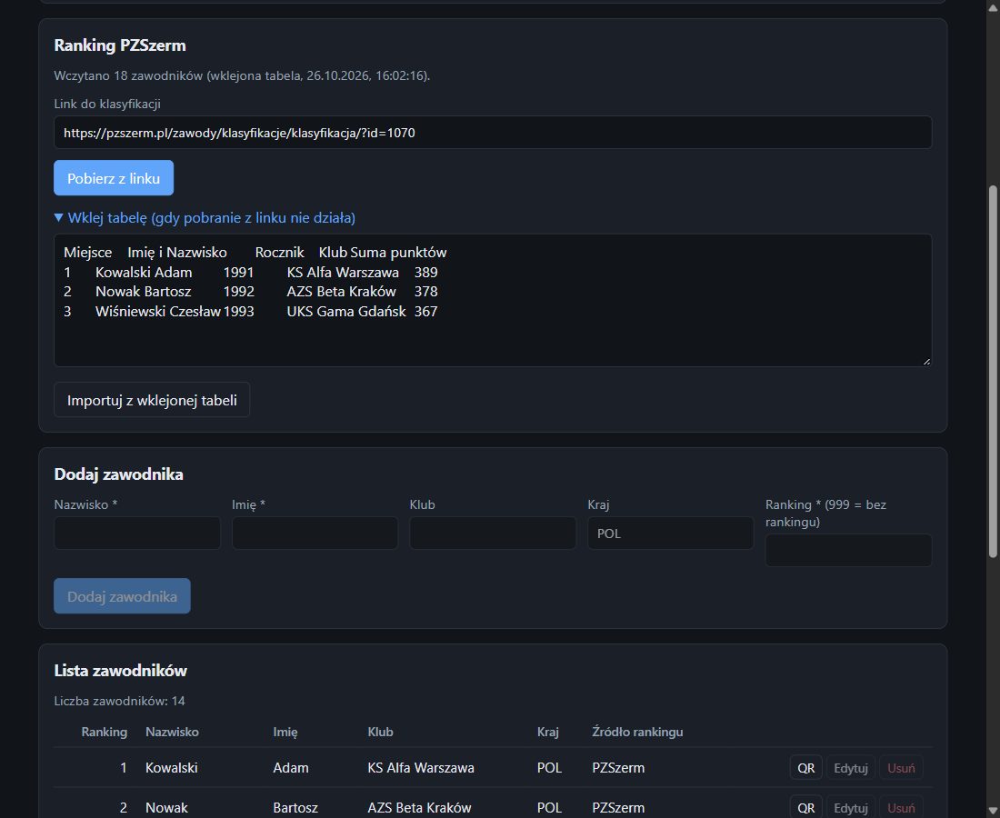
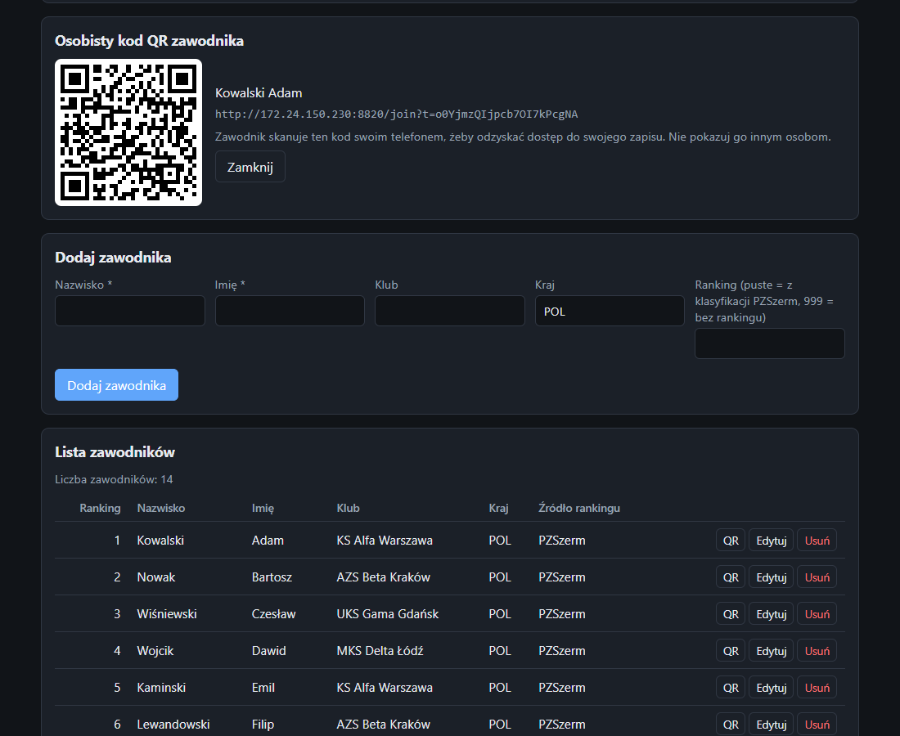
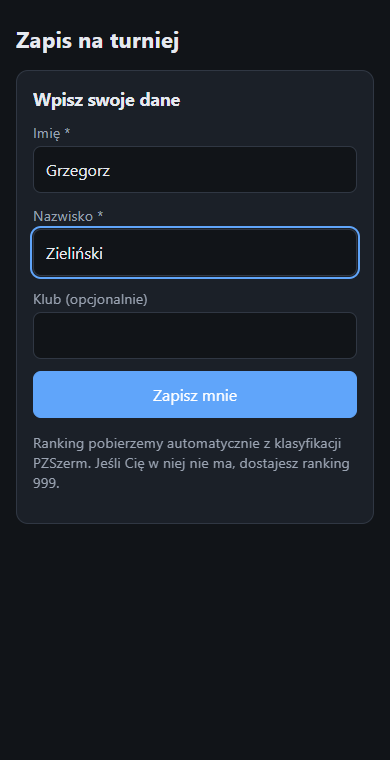
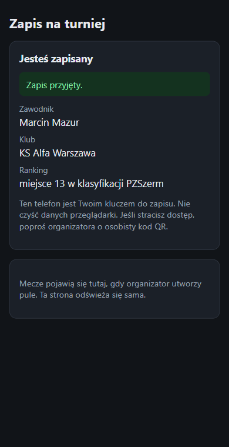
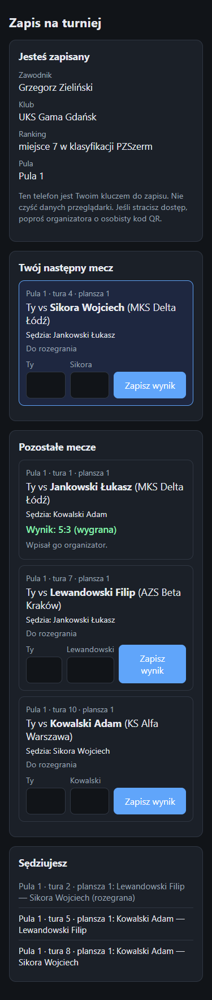
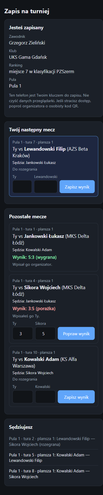
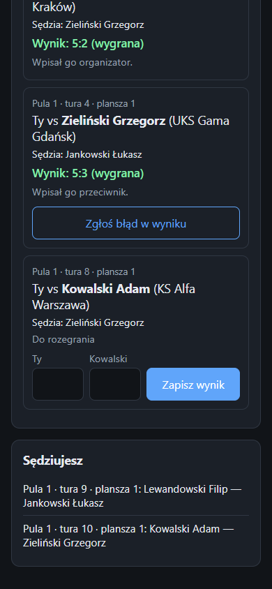
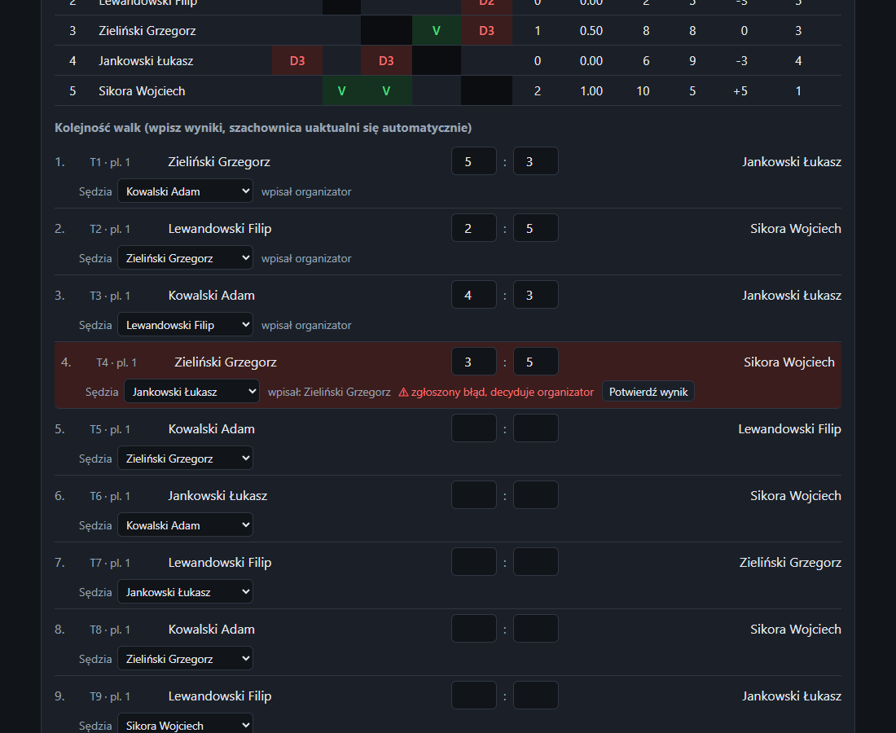

# Turniej szpadziarski: instrukcja obsługi

Aplikacja do prowadzenia fazy grup turnieju: zawodnicy zapisują się sami z telefonu (kod QR), ranking dobiera się z klasyfikacji PZSzerm, organizator tworzy grupy, a zawodnicy widzą swoje mecze i wpisują wyniki z telefonu.

Zrzuty ekranu pochodzą z danych demonstracyjnych (fikcyjni zawodnicy i kluby).

## Spis treści
1. [Jak to działa](#1-jak-to-działa)
2. [Uruchomienie](#2-uruchomienie)
3. [Przed turniejem: zapisy i ranking](#3-przed-turniejem-zapisy-i-ranking)
4. [Zapis zawodnika z telefonu](#4-zapis-zawodnika-z-telefonu)
5. [Tworzenie grup](#5-tworzenie-grup)
6. [Walki, plansze i sędziowie](#6-walki-plansze-i-sędziowie)
7. [Wyniki z telefonów zawodników](#7-wyniki-z-telefonów-zawodników)
8. [Ranking po grupach i awans](#8-ranking-po-grupach-i-awans)
9. [Zamknięcie grupy, usunięcie grup, zakończenie](#9-zamknięcie-grupy-usunięcie-grup-zakończenie)
10. [Gdy coś nie działa](#10-gdy-coś-nie-działa)
11. [Dane i bezpieczeństwo](#11-dane-i-bezpieczeństwo)

---

## 1. Jak to działa

Są dwa widoki:

| Kto | Adres | Co robi |
|---|---|---|
| **Organizator** | `http://localhost:8000/admin` (komputer z serwerem), za PIN-em | zapisy i QR, ranking PZSzerm, lista zawodników, grupy, plansze, sędziowie, wyniki, awans |
| **Zawodnik** | `http://<adres komputera>:8000/join` (z telefonu, po zeskanowaniu QR) | zapis, swój następny mecz, swoje mecze, wpisywanie wyniku, zgłaszanie błędu, lista walk do sędziowania |

Zawodnik widzi **własne mecze**. Dopiero **po zakończeniu jego grupy** (wszystkie walki mają wyniki, żaden wynik nie jest zgłoszony jako błędny) dostaje też szachownicę swojej grupy oraz ranking wszystkich grup. Podgląd grup innych zawodników jest dostępny w zakładce Wszystkie grupy (składy i wyniki). Nie widzi cudzych osobistych kodów ani danych kontaktowych.

**Język:** w prawym górnym rogu obu stron są flagi, którymi przełączasz język między polskim a angielskim (wybór zapamiętuje przeglądarka). Dodanie `?lang=en` do adresu strony też włącza angielski. Tłumaczone są teksty interfejsu i komunikaty serwera. Nazwiska, kluby i nazwy z danych turnieju zostają bez zmian.

Kolejność pracy: **zapisy** → **ranking PZSzerm** → **utworzenie grup** (lista zawodników się blokuje, zapisy zamykają) → **walki i wyniki** → **ranking i awans**.

## 2. Uruchomienie

1. Na komputerze organizatora kliknij dwukrotnie `start.bat` w folderze aplikacji (albo wpisz `python server.py`). `start.bat` po chwili sam otwiera panel organizatora w przeglądarce (`http://localhost:8000/admin`). Potrzebny jest Python 3.7 lub nowszy, nic więcej nie trzeba instalować.
2. W oknie serwera pojawią się trzy ważne informacje:
   - adres panelu organizatora (`http://localhost:8000/admin`),
   - adres zapisu dla telefonów (`http://192.168.x.x:8000/join`),
   - **PIN organizatora** (6 cyfr, losowy przy każdym starcie; stały PIN ustawisz zmienną środowiskową `ADMIN_PIN`).
3. Przy pierwszym uruchomieniu Windows zapyta o zaporę. Zezwól Pythonowi na dostęp do **sieci prywatnej**, inaczej telefony nie połączą się z serwerem.
4. Komputer i telefony zawodników muszą być w **tej samej sieci Wi-Fi**.
5. Okno serwera musi pozostać otwarte przez cały turniej. Zatrzymanie: `Ctrl+C`.

### Logowanie do panelu

Otwórz `http://localhost:8000/admin` i wpisz PIN z okna serwera.

Po 10 błędnych próbach PIN-u serwer blokuje logowanie na minutę.

## 3. Przed turniejem: zapisy i ranking

Karta **Zawodnicy** zawiera trzy ważne panele.

### Zapisy przez telefon (kod QR)

- Panel **Zapisy przez telefon** pokazuje kod QR i adres. Wyświetl go na ekranie lub wydrukuj. Zawodnicy skanują go aparatem telefonu.
- Przycisk **Zamknij zapisy / Otwórz zapisy** wstrzymuje i wznawia zapisy. Zapisy zamykają się też **automatycznie po utworzeniu grup**.

### Ranking PZSzerm

Ranking zawodnika to jego **miejsce w klasyfikacji PZSzerm**. Zawodnik, którego tam nie ma, dostaje ranking **999** (najniższy).

Serwer **nie pobiera** klasyfikacji ze strony PZSzerm (strona wymaga przeglądarki z JavaScript i cookies, a aplikacja nie obchodzi tej ochrony). Klasyfikację wczytuje się z pliku:

1. Otwórz klasyfikację PZSzerm w swojej przeglądarce.
2. Zapisz stronę (`Ctrl+S`, typ „Strona internetowa, tylko HTML”).
3. W panelu **Ranking PZSzerm** wybierz plik w polu **Plik klasyfikacji** i kliknij **Importuj z pliku**. Z pliku brana jest tylko tabela z nagłówkiem „Miejsce”.
4. Panel pokaże, ile zawodników wczytano i ilu zapisanym zawodnikom zaktualizowano ranking. Import można powtórzyć w dowolnym momencie, **do utworzenia grup**.

**Podgląd klasyfikacji** (rozwijane pole pod przyciskiem) pokazuje wszystko, co wczytano: miejsce, imię i nazwisko, klub oraz zapisanego zawodnika, do którego wpis został dopasowany. Pole **Szukaj** filtruje listę. Poniżej są **pominięte wiersze**, czyli takie, w których nie rozpoznano miejsca lub nazwiska. Użyj podglądu, gdy któryś zawodnik dostał 999, choć jest w klasyfikacji.

Zasady dopasowania zawodnika do klasyfikacji:

- nie ma znaczenia wielkość liter ani polskie znaki (`Walach` = `Wałach`),
- kolejność jest bez znaczenia (`Jan Kowalski` = `Kowalski Jan`),
- jeżeli w klasyfikacji są dwie osoby o tym samym imieniu i nazwisku, zawodnik dostaje 999 i oznaczenie „niejednoznaczny w PZSzerm” (sprawdź go ręcznie),
- zawodnik z klasyfikacji dostaje też **klub z PZSzerm**.

### Lista zawodników

Pod panelami jest lista z kolumną **Źródło rankingu** (PZSzerm / brak w PZSzerm / niejednoznaczny / ręcznie).

- **Dodaj zawodnika** ręcznie (np. gdy ktoś nie ma telefonu): nazwisko, imię, klub (opcjonalnie), kraj, ranking. **Puste pole rankingu** oznacza dopasowanie z wczytanej klasyfikacji PZSzerm (ranking i klub, tak samo jak przy zapisie z telefonu; brak w klasyfikacji = 999). Wpisany numer rankingu (999 = bez rankingu) zostaje ręczny i nie zmienia się przy kolejnych importach. Zawodnicy dopasowani automatycznie są przeliczani przy ponownym imporcie klasyfikacji.
- **Edytuj** i **Usuń** działają do utworzenia grup.
- **Duplikaty są blokowane**: ten sam zawodnik (po normalizacji nazwiska) nie zapisze się drugi raz, a ranking inny niż 999 może mieć tylko jedna osoba.

### Osobisty kod QR zawodnika

Przycisk **QR** przy zawodniku pokazuje jego osobisty kod. Zawodnik, który zgubił dostęp (wyczyszczone dane telefonu, nowy telefon), skanuje go i znów widzi swoje mecze. **Nie pokazuj go innym osobom.**

## 4. Zapis zawodnika z telefonu

1. Zawodnik skanuje kod QR i wpisuje **imię i nazwisko** (klub opcjonalnie).
2. Aplikacja szuka go w klasyfikacji PZSzerm i od razu pokazuje przypisany ranking.

| Formularz | Po zapisie |
|---|---|
|  |  |

- Jeżeli taki zawodnik już się zapisał, telefon pokaże komunikat i podpowie, żeby poprosić organizatora o osobisty QR.
- Telefon zapamiętuje zapis. Po ponownym otwarciu strony zawodnik od razu widzi swój profil. **Nie należy czyścić danych przeglądarki.**
- Strona na telefonie odświeża się sama co kilka sekund: gdy organizator utworzy grupy, mecze pojawią się bez przeładowania.

## 5. Tworzenie grup

Karta **Grupy** → **Ustawienia grup**.

| Pole | Znaczenie |
|---|---|
| **Rozmiar grupy** | ilu zawodników w grupie; liczba grup liczy się sama (np. 14 zawodników i rozmiar 5 = 3 grupy). Domyślnie rozmiar równa się liczbie zawodników, czyli **jedna grupa**; pole nie przyjmie więcej niż liczba zawodników |
| **Górny limit plansz na grupę** | maksymalna liczba plansz dla każdej grupy (można zmienić później dla pojedynczej grupy); aplikacja stara się wykorzystać tyle plansz, ale nie kosztem sędziowania, patrz rozdział 6 |
| **Liczba awansujących (osób)** | ilu zawodników awansuje do drabinki; domyślnie 80% zawodników, zaokrąglone w dół; pole nie przyjmie więcej niż liczba zawodników |

Przycisk **Utwórz grupy**:

- dzieli zawodników **„wężem” po rankingu** (grupa 1 dostaje rankingi 1, 6, 7, grupa 2 dostaje 2, 5, 8 itd.), przy remisie rankingu (np. kilku zawodników z 999) decyduje czas zapisu,
- **losuje pozycje zawodników w każdej grupie** (numery w szachownicy i kolejność walk): skład grupy wynika z rankingu, ale kto jest pod którym numerem, jest przypadkowe,
- **blokuje listę zawodników** i **zamyka zapisy**,
- układa kolejność walk dla każdej grupy.

### Ręczne przenoszenie zawodników między grupami

Po utworzeniu grup możesz ręcznie zmienić, kto z kim walczy (np. 7 zawodników musi być w grupach 4 i 3, a chcesz je pomieszać inaczej niż według rankingu). W szachownicy, obok nazwiska zawodnika, jest lista **Przenieś do…** z pozostałymi grupami. Po wyborze zawodnik trafia do wybranej grupy w losowe miejsce, a kolejność walk w obu grupach jest układana od nowa (wraz z sędziami; ręcznie ustawieni sędziowie w tych grupach są resetowani).

- Przenoszenie działa tylko, gdy **w żadnej z dwóch grup nie ma jeszcze wyników**.
- W grupie muszą zostać co najmniej dwie osoby.
- Żeby zamienić dwóch zawodników miejscami, przenieś każdego z nich do grupy drugiego.

Przycisk **Usuń grupy i odblokuj listę** kasuje grupy wraz z wynikami (wymaga potwierdzenia). Zapisy trzeba wtedy otworzyć ręcznie w karcie Zawodnicy.

## 6. Walki, plansze i sędziowie

W każdej grupie jest **szachownica** (wyniki każdy z każdym) i pod nią **kolejność walk**. Wyniki wpisuje się w kolejności walk, a szachownica uzupełnia się sama.

### Tury i plansze

- Walki są podzielone na **tury**. W jednej turze odbywa się tyle walk naraz, ile jest plansz, i nikt nie walczy dwa razy w tej samej turze.
- Przy walce widać `T2 · pl. 4` czyli **tura 2, plansza 4**. Numery plansz są ciągłe w całym turnieju: grupa 1 dostaje plansze 1…k1, grupa 2 kolejne itd.
- Układ jest dobierany tak, żeby jak najmniej zawodników walczyło **kilka razy pod rząd**.
- **Górny limit plansz** można zmienić dla każdej grupy polem i przyciskiem **Ustaw limit plansz** (kolejność walk zostanie ułożona od nowa). Zmiana jest możliwa tylko, dopóki w grupie nie ma wyników.
- Limit plansz to **górna granica**, nie gwarancja. Aplikacja stara się wykorzystać maksymalną liczbę plansz, ale **ważniejsze jest sędziowanie**: na jedną planszę potrzeba 2 walczących i 1 sędziego z tej samej grupy, więc grupa używa najwyżej tylu plansz, ile mieści się w trójkach (liczba zawodników podzielona przez 3). Np. przy limicie 2 plansz i 5 zawodnikach walki idą po jednej naraz (jedna walka plus sędzia). Gdy użyto mniej plansz niż limit, pod nagłówkiem grupy pojawia się informacja.

### Sędziowie

- Do każdej walki aplikacja wybiera **sędziego spośród zawodników tej samej grupy**, którzy w tej turze nie walczą. Preferuje tych, którzy nie walczą też w następnej turze i sędziowali dotąd najmniej, najlepiej z innego klubu niż walczący. Układ tur jest tak planowany, żeby **każda walka miała sędziego z tej samej grupy**, nawet jeśli oznacza to mniej plansz niż limit (patrz wyżej).
- Sędziego można **zmienić ręcznie** w liście rozwijanej przy walce, także na zawodnika z innej grupy.

### Ostrzeżenia (czerwone)

| Komunikat | Co oznacza | Co zrobić |
|---|---|---|
| **zalecana przerwa: Nazwisko** | zawodnik walczy zaraz po poprzedniej walce (przy małych grupach bywa to nieuniknione) | zaplanuj krótką przerwę |
| **brak sędziego** | zdarza się tylko w grupie 2 osób (nie ma kogo wyznaczyć w grupie) | wskaż sędziego ręcznie, także z innej grupy |
| **Walk bez przerwy / bez sędziego: N** (pod nagłówkiem grupy) | podsumowanie dla całej grupy | zmień górny limit plansz albo wskaż sędziów |

## 7. Wyniki z telefonów zawodników

### Widok zawodnika

Po utworzeniu grup telefon pokazuje:

- **Twój następny mecz**: grupa, tura, plansza, przeciwnik z klubem, sędzia, pola na wynik,
- **Pozostałe mecze** ze statusem i wynikami,
- **Sędziujesz**: walki, które zawodnik ma sędziować (tura, plansza, kto walczy).

### Wpisywanie wyniku

- Zawodnik wpisuje wynik **swojej walki**: najpierw swoje trafienia, potem przeciwnika. Zwycięzca ma więcej trafień niż przeciwnik, **maksymalnie 5** (np. 5:3, a gdy walka kończy się na czas, np. 4:3). Remis (3:3, 5:5) i wyniki powyżej 5 (6:0) są odrzucane. W szachownicy wygrana z 5 trafieniami jest oznaczona **V**, a wygrana na czas z mniejszą liczbą trafień jako **V4**, **V3** itd. (liczba to trafienia zwycięzcy). Porażka pokazuje się jako **D** z liczbą własnych trafień.
- Wynik może wpisać **którykolwiek z dwóch zawodników walki**. Wynik liczy się od razu, szachownica i ranking uaktualniają się u organizatora w ciągu kilku sekund.
- **Po zapisaniu wynik jest zablokowany.** Zawodnik nie może go sam poprawić. Jeśli pomylił się przy wpisywaniu, klika **Poproś o zgodę na poprawę wyniku**. U organizatora ta walka dostaje niebieski pasek, dopisek „prośba o poprawę wyniku” i przycisk **Zatwierdź poprawę**. Po zatwierdzeniu zawodnik może **jeden raz** zmienić wynik (wtedy blokada wraca). Organizator może też w każdej chwili sam wpisać poprawny wynik, co kasuje prośbę.

### Szachownica grupy i ranking na telefonie

Gdy wszystkie walki grupy mają wyniki, na telefonie zawodnika pojawia się panel **Wyniki Twojej grupy**: szachownica jak u organizatora (**V** to wygrana z 5 trafieniami, **V4** itd. wygrana na czas, **D3** porażka z 3 trafieniami) oraz V, V/M, TS, TR, Ind i miejsce w grupie. Własny wiersz jest wyróżniony, żeby zawodnik mógł sprawdzić swoje wyniki. Jeśli coś się nie zgadza, zgłasza to organizatorowi.

Przycisk **Pokaż ranking wszystkich grup** otwiera ranking po grupach (miejsce, nazwisko, klub, grupa, V, M, V/M, TS, TR, Ind). Dopóki nie wszystkie grupy są zakończone, ranking może się zmieniać, a kolumna **Awans** pojawia się dopiero po zakończeniu wszystkich grup. Zawodnik, którego grupa nie jest jeszcze zakończona, nie widzi ani szachownicy, ani rankingu.

### Zgłaszanie błędu

Przeciwnik widzi wynik (odwrócony na swoją korzyść) i przycisk **Zgłoś błąd w wyniku**. Po zgłoszeniu zawodnicy nie mogą już zmieniać tego wyniku, decyduje organizator.

### Co widzi organizator

Zgłoszona walka jest **podświetlona na czerwono** z dopiskiem, kto wpisał wynik. Organizator ma dwie możliwości: **poprawić wynik** (wpisuje nowy, zgłoszenie znika) albo kliknąć **Potwierdź wynik** (wynik zostaje bez zmian). Wyniku wpisanego przez organizatora zawodnicy nie mogą zmienić ani zgłosić.

Panel organizatora **odświeża się sam co 5 sekund** (wyniki i zapisy z telefonów pojawiają się bez przeładowania). Lista walk, w której właśnie piszesz, nie jest nadpisywana.

## 8. Ranking po grupach i awans

Na dole karty **Grupy** jest **Ranking wszystkich grup**, uporządkowany według: **V/M** (procent wygranych), potem **Ind** (różnica trafień), potem **TS** (trafienia zadane). Remisy mają wspólne miejsce z literą T (np. `2T`).

- Kolumna **Awans** pojawia się dopiero **po zakończeniu wszystkich grup** i oznacza tylu zawodników, ile ustawiono w polu „Liczba awansujących”. Liczbę można zmienić w dowolnym momencie.
- Przy remisie na granicy awansu o awansie decyduje pozycja w tabeli. Sprawdź tę sytuację ręcznie.

## 9. Zamknięcie grupy, usunięcie grup, zakończenie

- **Zamknij grupę** (przycisk przy nagłówku grupy): zamknięta grupa nie przyjmuje wyników z telefonów, a organizator nadal może je wpisywać. Użyj tego po zakończeniu grup, żeby nikt nie zmienił wyniku. Przycisk **Otwórz grupę** cofa zamknięcie.
### Zatwierdzenie grup, druga tura grup i drabinka

Na dole karty **Grupy** jest panel **Zatwierdzenie grup** z przyciskiem **Wszystkie grupy zatwierdzone**. Przycisk jest aktywny dopiero, gdy wszystkie walki mają wyniki i nie ma zgłoszonych błędów ani próśb o poprawę. Po zatwierdzeniu wyniki są zamrożone (organizator i zawodnicy ich nie zmieniają), a telefony pokazują grupy jako zamknięte. Zatwierdzenie można cofnąć przyciskiem **Cofnij zatwierdzenie**. Potem wybierasz jedną z dwóch opcji:

**Opcja A: druga tura grup.** Podajesz rozmiar grupy i górny limit plansz. **Wszyscy zawodnicy** są ponownie dzieleni na grupy wężem według rankingu po grupach z pierwszej tury (kolejność w grupach jest losowana, tak jak przy pierwszej turze). Ranking pierwszej tury zostaje zapisany i widać go w rozwijanym polu **Ranking po 1. turze**. Druga tura używa tych samych zasad (szachownica, sędziowie, plansze, wyniki z telefonów, zatwierdzenie). Drugą turę można utworzyć tylko raz.

**Opcja B: drabinka direct elimination.** Podajesz liczbę zawodników w drabince **albo procent wszystkich zawodników** (np. 83%). Oba pola są powiązane: zmiana jednego przelicza drugie, a pod nimi widać, ilu zawodników i jaka tabela z tego wyjdzie (domyślnie liczba awansujących). Zawodnicy są rozstawieni według rankingu po grupach (po drugiej turze, jeśli była), a drabinka ma rozmiar najbliższej potęgi dwójki. Rozstawienie jest standardowe (jak FIE): #1 na samej górze tabeli, #2 na samym dole, a #3 i #4 w środkowych ćwiartkach, więc najwyżej rozstawieni spotykają się najpóźniej (np. dla 8: 1-8, 4-5, 3-6, 2-7). Gdy liczba zawodników nie jest potęgą dwójki, najniżej rozstawieni grają **dobijaki** (pierwsza runda), a najwyżej rozstawieni dostają **wolny los**. Przy tworzeniu drabinki można zaznaczyć **„Z repasażami”** i wybrać, do którego miejsca (domyślnie 16). **Repasaże** to walki o miejsca: przegrani rundy grają między sobą klasyfikację, a nie odpadają bez miejsca. Np. przegrani ćwierćfinałów (miejsca 5–8) grają półfinały, walkę o 5. i o 7. miejsce, a przegrani 1/8 (miejsca 9–16) rozgrywają osobną tabelę z pełną klasyfikacją (walki o 9., 11., 13. i 15. miejsce). Przegrani półfinałów grają jak dotąd o 3. miejsce. Repasaże powstają dla rund, w których wszystkie walki są realne (bez wolnych losów) i liczba przegranych jest potęgą dwójki, a dobijaki ich nie mają. Zwycięzcy i przegrani repasaży trafiają do kolejnych walk automatycznie, a walki są ponumerowane w tej samej kolejności co reszta drabinki (pod główną tabelą każda grupa miejsc to zestaw **tabelek ułożonych w tych samych kolumnach (kolumna = etap), upakowanych blisko siebie**: każda następna wskakuje w najwyższe wolne miejsce pod poprzednią, więc nie ma dużych pustych przestrzeni. Np. dla miejsc 9–16 pierwsza tabelka prowadzi od pierwszej rundy przez półfinały do walki o 9. miejsce, pod nią jest walka o 11. miejsce, potem tabelka o miejsca 13–16 z walką o 13. miejsce i na końcu walka o 15. miejsce. Strzałki (jak w głównej tabeli) pokazują drogę zwycięzców i nigdzie się nie przecinają, a dokąd trafia przegrany, mówi linia na karcie, np. „Zwycięzca → walka 90 · przegrany → walka 94”). Sędziów repasaży przydziela się automatycznie jak w głównej tabeli, a wyniki wpisuje organizator.

Drabinkę widać w karcie **Drabinka** w układzie klasycznej tabeli: każdy etap (dobijaki, ćwierćfinały, półfinały, finał) to osobna kolumna, a walki są rozmieszczone tak, że walka następnego etapu stoi dokładnie pośrodku dwóch walk, z których wynika. Strzałki pokazują, do którego miejsca w następnej walce trafi zwycięzca, a dla jeszcze nierozegranych walk widać opis „Zwycięzca walki N” (walki są ponumerowane). Strzałki zwycięzców są wyróżnione kolorem. Wyniki wpisuje wyłącznie organizator (do 15 trafień, bez remisów), a zwycięzca przechodzi dalej automatycznie. Przegrani półfinałów grają **walkę o 3. miejsce** (przy 3 zawodnikach w drabince nie ma półfinałów z dwiema realnymi parami, więc walki o 3. miejsce nie ma). Zmiany wyniku nie da się zrobić, jeśli walka następnej rundy ma już wynik (najpierw usuń ten wynik). Przycisk **Usuń drabinkę** kasuje drabinkę, po czym można cofnąć zatwierdzenie albo utworzyć drugą turę.

**Sędziowie w drabince przydzielają się automatycznie**, gdy znani są obaj zawodnicy walki (po utworzeniu drabinki dla dobijaków i pierwszych walk, a potem w miarę jak zwycięzcy trafiają do kolejnych walk). Kolejność preferencji: ktoś spoza drabinki (nie awansował), potem zawodnik, który już odpadł, potem ktoś wolny w tej rundzie (np. z wolnym losem), a na końcu walczący w tej samej rundzie. Dalej wybierany jest ten, kto sędziuje najmniej, nie sędziuje innej walki tej rundy i jest z innego klubu niż walczący. Organizator może w każdej walce **zmienić sędziego ręcznie** (lista poza walczącymi); ręcznie ustawiony sędzia nie jest nadpisywany. Walki z wolnym losem nie mają sędziego.

**Telefon zawodnika:** po utworzeniu drabinki na telefonie pojawia się zakładka **Drabinka** z tym samym układem tabeli (tylko do podglądu, wyników z telefonu nie wpisuje się). Na górze zakładki zawodnik widzi **swoją następną walkę w drabince**: etap, numer walki, przeciwnika, sędziego i miejsce na wynik (wpisuje je organizator). Gdy przeciwnik nie jest jeszcze znany, jest informacja, że zostanie nim zwycięzca konkretnej walki (podany numer). Zawodnik widzi też walki w drabince, które ma sędziować, oraz komunikat, gdy odpadł lub wygrał. Na telefonie drabinka **sama dopasowuje skalę do szerokości ekranu** (nie mniej niż 60%, resztę można przewinąć), a przyciski **−**, **+** i **Dopasuj** nad tabelą zmieniają rozmiar ręcznie. Pasek **Od etapu** chowa wcześniejsze etapy (wtedy tabela jest większa). **Po obróceniu telefonu** strona przechodzi na szerszy układ: karty w zakładce Mecze układają się w dwie kolumny, a drabinka przelicza skalę do nowej szerokości. Własny wiersz w tabeli jest podkreślony. Przycisk **Znajdź w drabince** przy następnej walce przewija tabelę do tej walki i na chwilę ją podświetla (następna walka ma też stałą, kolorową ramkę).

Telefon ma zakładki: **Grupa** (na górze szachownica własnej grupy po jej zakończeniu, pod spodem profil, mecze w grupie i sędziowanie), **Wszystkie grupy** (podgląd składów i wyników wszystkich grup na żywo), **Ranking** (ranking wszystkich grup; bieżący widać po zakończeniu własnej grupy) oraz **Drabinka**. Po utworzeniu **drugiej tury grup** zakładki pierwszej tury zostają (Grupa, Wszystkie grupy, Ranking pokazują wtedy turę 1, gotową do przejrzenia), a obok pojawiają się **Grupa 2**, **Wszystkie grupy 2** i **Ranking 2** dla drugiej tury. Pasek zakładek można przewijać w bok.

- **Usuń grupy i odblokuj listę**: kasuje grupy i wszystkie wyniki.
- **Nowy turniej** (karta Zawodnicy, na dole): zapisuje kopię bieżących danych w folderze `archiwum/` (plik `turniej-RRRR-MM-DD_GG-MM-SS.json`) i czyści zawodników, grupy, wyniki oraz ustawienia zapisów. Wczytana klasyfikacja PZSzerm zostaje, żeby nie importować jej drugi raz. Telefony ze starego turnieju przestają działać i zawodnicy zapisują się od nowa. Wymaga potwierdzenia.
- Po turnieju skopiuj plik `data.json` jako archiwum (zawiera zawodników, ranking, grupy i wyniki).

## 10. Gdy coś nie działa

| Problem | Przyczyna i rozwiązanie |
|---|---|
| Telefon nie otwiera strony zapisu | Telefon nie jest w tej samej sieci Wi-Fi albo zapora Windows blokuje Pythona (zezwól na sieć prywatną). Niektóre sieci publiczne i gościnne izolują urządzenia od siebie, wtedy użyj własnego routera lub hotspotu |
| Kod QR prowadzi pod zły adres | Aplikacja wybiera adres karty sieciowej komputera. Przy kilku kartach (VPN, Wi-Fi + Ethernet) wyłącz zbędne albo otwórz panel pod adresem sieciowym komputera, a QR użyje tego adresu |
| Import z pliku nie rozpoznaje tabeli | Zapisz stronę jako „tylko HTML” bezpośrednio z klasyfikacji (tabela musi mieć nagłówek „Miejsce”). Sprawdź **Pominięte wiersze** w podglądzie |
| Zawodnik ma 999, choć jest w klasyfikacji | Nazwisko zapisane inaczej (np. dwa imiona). Edytuj zawodnika ręcznie i wpisz jego miejsce |
| Zawodnik zgubił telefon lub dostęp | Przycisk **QR** przy zawodniku w panelu, a zawodnik skanuje swój osobisty kod |
| „Taki zawodnik jest już zapisany” | Duplikat (to samo imię i nazwisko). Jeśli to inna osoba o tym samym nazwisku, dodaj ją ręcznie z innym zapisem (np. dopiskiem w nazwisku) |
| „Zbyt wiele błędnych prób PIN-u” | Odczekaj minutę. PIN jest w oknie serwera |
| Zmiana limitu plansz niemożliwa | W grupie są już wyniki. Zmiana limitu zmieniłaby kolejność walk |
| Po restarcie komputera brak danych | Dane są w pliku `data.json` obok serwera i wracają po ponownym uruchomieniu. Żeby zacząć od zera, użyj przycisku **Nowy turniej** (karta Zawodnicy). Zmieniony jest tylko PIN (losowy), chyba że ustawiono `ADMIN_PIN` |

## 11. Dane i bezpieczeństwo

- Wszystkie dane są w pliku `data.json` w folderze aplikacji. Nie wysyłamy ich do żadnych usług zewnętrznych. Plik zawiera imiona, nazwiska i **osobiste tokeny zawodników**, więc nie publikuj go.
- Panel organizatora chroni PIN. Telefony zawodników nie mają dostępu do panelu, listy zawodników ani cudzych meczów.
- Połączenie jest zwykłe (HTTP, bez szyfrowania), bo aplikacja jest przeznaczona do lokalnej sieci Wi-Fi turnieju. Nie wystawiaj jej do internetu.
- Aplikacja nie łączy się ze stroną PZSzerm. Klasyfikację wczytujesz z pliku zapisanego w Twojej przeglądarce.

## Pliki aplikacji

| Plik | Do czego |
|---|---|
| `start.bat` | uruchomienie serwera |
| `server.py`, `schedule.py` | serwer, układanie tur, plansz i sędziów |
| `static/admin.html`, `static/join.html`, `static/qrcode.js`, `static/i18n.js` | panel organizatora, strona zawodnika, generator kodów QR, przełącznik języka PL/EN (słownik tłumaczeń) |
| `data.json` | dane turnieju (powstaje przy pierwszym zapisie) |
| `archiwum/` | kopie zakończonych turniejów (powstają przy „Nowy turniej”, zawierają dane osobowe, nie publikuj) |
| `legacy-offline.html` | stara wersja bez serwera (tylko zawodnicy i grupy w jednej przeglądarce), zostawiona na wszelki wypadek |
| `docs/` | zrzuty ekranu do tej instrukcji |
