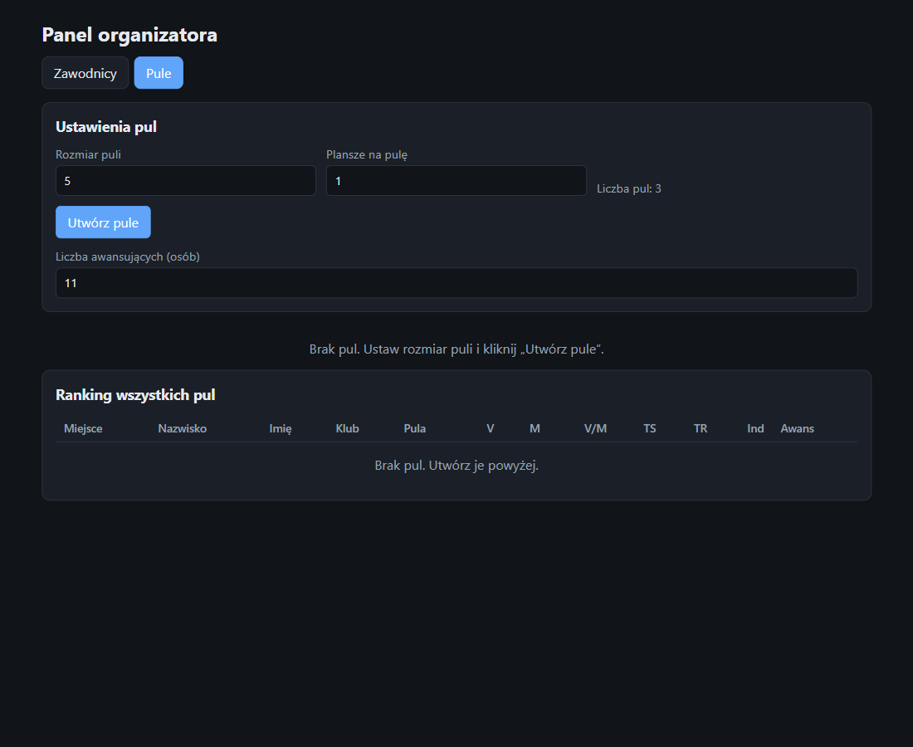
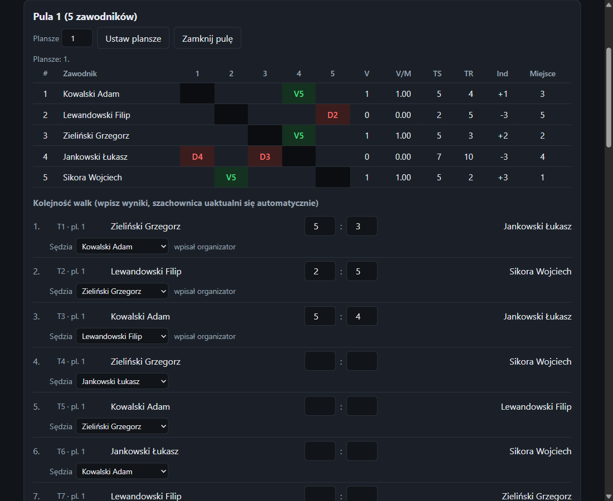
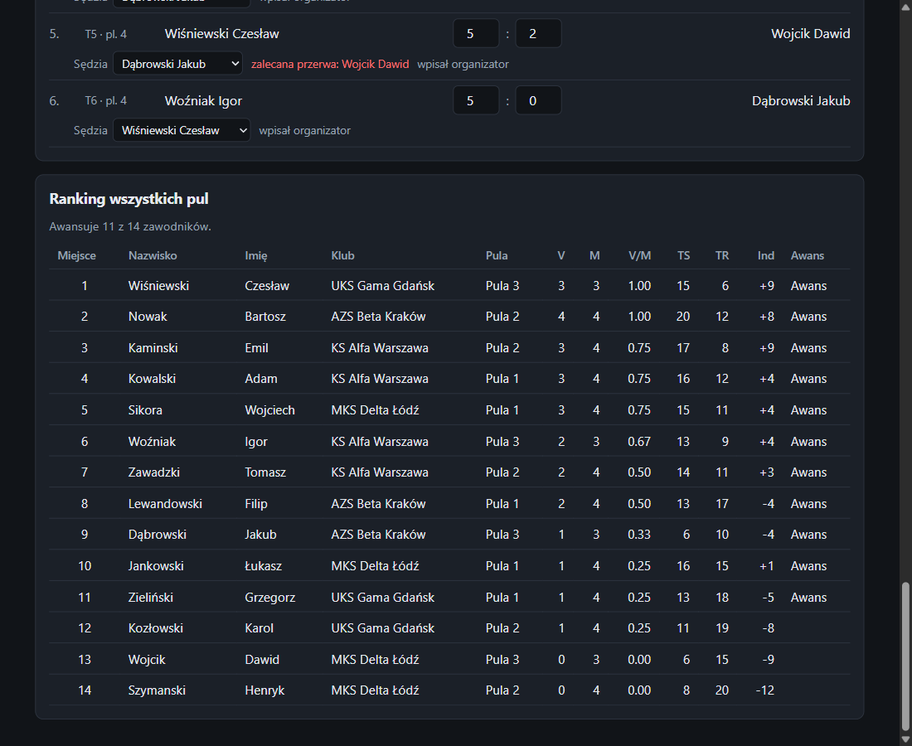

# Turniej szpadziarski: instrukcja obsługi

Aplikacja do prowadzenia fazy pul turnieju: zawodnicy zapisują się sami z telefonu (kod QR), ranking dobiera się z klasyfikacji PZSzerm, organizator tworzy pule, a zawodnicy widzą swoje mecze i wpisują wyniki z telefonu.

Zrzuty ekranu pochodzą z danych demonstracyjnych (fikcyjni zawodnicy i kluby).

## Spis treści
1. [Jak to działa](#1-jak-to-działa)
2. [Uruchomienie](#2-uruchomienie)
3. [Przed turniejem: zapisy i ranking](#3-przed-turniejem-zapisy-i-ranking)
4. [Zapis zawodnika z telefonu](#4-zapis-zawodnika-z-telefonu)
5. [Tworzenie pul](#5-tworzenie-pul)
6. [Walki, plansze i sędziowie](#6-walki-plansze-i-sędziowie)
7. [Wyniki z telefonów zawodników](#7-wyniki-z-telefonów-zawodników)
8. [Ranking po pulach i awans](#8-ranking-po-pulach-i-awans)
9. [Zamknięcie puli, usunięcie pul, zakończenie](#9-zamknięcie-puli-usunięcie-pul-zakończenie)
10. [Gdy coś nie działa](#10-gdy-coś-nie-działa)
11. [Dane i bezpieczeństwo](#11-dane-i-bezpieczeństwo)

---

## 1. Jak to działa

Są dwa widoki:

| Kto | Adres | Co robi |
|---|---|---|
| **Organizator** | `http://localhost:8000/admin` (komputer z serwerem), za PIN-em | zapisy i QR, ranking PZSzerm, lista zawodników, pule, plansze, sędziowie, wyniki, awans |
| **Zawodnik** | `http://<adres komputera>:8000/join` (z telefonu, po zeskanowaniu QR) | zapis, swój następny mecz, swoje mecze, wpisywanie wyniku, zgłaszanie błędu, lista walk do sędziowania |

Zawodnik widzi **tylko własne mecze**. Nie widzi innych pul, cudzych meczów ani rankingu.

Kolejność pracy: **zapisy** → **ranking PZSzerm** → **utworzenie pul** (lista zawodników się blokuje, zapisy zamykają) → **walki i wyniki** → **ranking i awans**.

## 2. Uruchomienie

1. Na komputerze organizatora kliknij dwukrotnie `start.bat` w folderze aplikacji (albo wpisz `python server.py`). Potrzebny jest Python 3.7 lub nowszy, nic więcej nie trzeba instalować.
2. W oknie serwera pojawią się trzy ważne informacje:
   - adres panelu organizatora (`http://localhost:8000/admin`),
   - adres zapisu dla telefonów (`http://192.168.x.x:8000/join`),
   - **PIN organizatora** (6 cyfr, losowy przy każdym starcie; stały PIN ustawisz zmienną środowiskową `ADMIN_PIN`).
3. Przy pierwszym uruchomieniu Windows zapyta o zaporę. Zezwól Pythonowi na dostęp do **sieci prywatnej**, inaczej telefony nie połączą się z serwerem.
4. Komputer i telefony zawodników muszą być w **tej samej sieci Wi-Fi**.
5. Okno serwera musi pozostać otwarte przez cały turniej. Zatrzymanie: `Ctrl+C`.

### Logowanie do panelu

Otwórz `http://localhost:8000/admin` i wpisz PIN z okna serwera.

Po 10 błędnych próbach PIN-u serwer blokuje logowanie na minutę.

## 3. Przed turniejem: zapisy i ranking

Karta **Zawodnicy** zawiera trzy ważne panele.

### Zapisy przez telefon (kod QR)

- Panel **Zapisy przez telefon** pokazuje kod QR i adres. Wyświetl go na ekranie lub wydrukuj. Zawodnicy skanują go aparatem telefonu.
- Przycisk **Zamknij zapisy / Otwórz zapisy** wstrzymuje i wznawia zapisy. Zapisy zamykają się też **automatycznie po utworzeniu pul**.

### Ranking PZSzerm

Ranking zawodnika to jego **miejsce w klasyfikacji PZSzerm**. Zawodnik, którego tam nie ma, dostaje ranking **999** (najniższy).

1. Link do klasyfikacji jest wpisany domyślnie. Przycisk **Pobierz z linku** próbuje pobrać tabelę.
2. **Strona PZSzerm zwykle blokuje pobieranie przez serwer** (wymaga przeglądarki z JavaScript i cookies). Aplikacja nie obchodzi tej ochrony. Wtedy pokaże komunikat i rozwinie pole **Wklej tabelę**.
3. Otwórz klasyfikację w swojej przeglądarce, zaznacz **całą tabelę od nagłówka „Miejsce”**, skopiuj (`Ctrl+C`) i wklej w polu. Kliknij **Importuj z wklejonej tabeli**.
4. Panel pokaże, ile zawodników wczytano i ilu zapisanym zawodnikom zaktualizowano ranking. Import można powtórzyć w dowolnym momencie, **do utworzenia pul**.

Zasady dopasowania zawodnika do klasyfikacji:

- nie ma znaczenia wielkość liter ani polskie znaki (`Walach` = `Wałach`),
- kolejność jest bez znaczenia (`Jan Kowalski` = `Kowalski Jan`),
- jeżeli w klasyfikacji są dwie osoby o tym samym imieniu i nazwisku, zawodnik dostaje 999 i oznaczenie „niejednoznaczny w PZSzerm” (sprawdź go ręcznie),
- zawodnik z klasyfikacji dostaje też **klub z PZSzerm**.

### Lista zawodników

Pod panelami jest lista z kolumną **Źródło rankingu** (PZSzerm / brak w PZSzerm / niejednoznaczny / ręcznie).

- **Dodaj zawodnika** ręcznie (np. gdy ktoś nie ma telefonu): nazwisko, imię, klub (opcjonalnie), kraj, ranking (999 = bez rankingu).
- **Edytuj** i **Usuń** działają do utworzenia pul.
- **Duplikaty są blokowane**: ten sam zawodnik (po normalizacji nazwiska) nie zapisze się drugi raz, a ranking inny niż 999 może mieć tylko jedna osoba.

### Osobisty kod QR zawodnika

Przycisk **QR** przy zawodniku pokazuje jego osobisty kod. Zawodnik, który zgubił dostęp (wyczyszczone dane telefonu, nowy telefon), skanuje go i znów widzi swoje mecze. **Nie pokazuj go innym osobom.**

## 4. Zapis zawodnika z telefonu

1. Zawodnik skanuje kod QR i wpisuje **imię i nazwisko** (klub opcjonalnie).
2. Aplikacja szuka go w klasyfikacji PZSzerm i od razu pokazuje przypisany ranking.

| Formularz | Po zapisie |
|---|---|
|  |  |

- Jeżeli taki zawodnik już się zapisał, telefon pokaże komunikat i podpowie, żeby poprosić organizatora o osobisty QR.
- Telefon zapamiętuje zapis. Po ponownym otwarciu strony zawodnik od razu widzi swój profil. **Nie należy czyścić danych przeglądarki.**
- Strona na telefonie odświeża się sama co kilka sekund: gdy organizator utworzy pule, mecze pojawią się bez przeładowania.

## 5. Tworzenie pul

Karta **Pule** → **Ustawienia pul**.

| Pole | Znaczenie |
|---|---|
| **Rozmiar puli** | ilu zawodników w puli; liczba pul liczy się sama (np. 14 zawodników i rozmiar 5 = 3 pule) |
| **Plansze na pulę** | ile plansz ma każda pula (można zmienić później dla pojedynczej puli) |
| **Liczba awansujących (osób)** | ilu zawodników awansuje do drabinki; domyślnie 80% zawodników, zaokrąglone w dół |

Przycisk **Utwórz pule**:

- dzieli zawodników **„wężem” po rankingu** (pula 1 dostaje rankingi 1, 6, 7, pula 2 dostaje 2, 5, 8 itd.), przy remisie rankingu (np. kilku zawodników z 999) decyduje czas zapisu,
- **blokuje listę zawodników** i **zamyka zapisy**,
- układa kolejność walk dla każdej puli.

Przycisk **Usuń pule i odblokuj listę** kasuje pule wraz z wynikami (wymaga potwierdzenia). Zapisy trzeba wtedy otworzyć ręcznie w karcie Zawodnicy.

## 6. Walki, plansze i sędziowie

W każdej puli jest **szachownica** (wyniki każdy z każdym) i pod nią **kolejność walk**. Wyniki wpisuje się w kolejności walk, a szachownica uzupełnia się sama.

### Tury i plansze

- Walki są podzielone na **tury**. W jednej turze odbywa się tyle walk naraz, ile jest plansz, i nikt nie walczy dwa razy w tej samej turze.
- Przy walce widać `T2 · pl. 4` czyli **tura 2, plansza 4**. Numery plansz są ciągłe w całym turnieju: pula 1 dostaje plansze 1…k1, pula 2 kolejne itd.
- Układ jest dobierany tak, żeby jak najmniej zawodników walczyło **kilka razy pod rząd**.
- **Plansze** można zmienić dla każdej puli polem i przyciskiem **Ustaw plansze** (kolejność walk zostanie ułożona od nowa). Zmiana jest możliwa tylko, dopóki w puli nie ma wyników.
- Jeśli plansz jest więcej niż potrzeba (np. 3 plansze, 4 zawodników), aplikacja użyje mniej i pokaże informację.

### Sędziowie

- Do każdej walki aplikacja wybiera **sędziego spośród zawodników tej samej puli**, którzy w tej turze nie walczą. Preferuje tych, którzy nie walczą też w następnej turze i sędziowali dotąd najmniej, najlepiej z innego klubu niż walczący.
- Sędziego można **zmienić ręcznie** w liście rozwijanej przy walce, także na zawodnika z innej puli.

### Ostrzeżenia (czerwone)

| Komunikat | Co oznacza | Co zrobić |
|---|---|---|
| **zalecana przerwa: Nazwisko** | zawodnik walczy zaraz po poprzedniej walce (przy małych pulach i dużej liczbie plansz bywa to nieuniknione) | zaplanuj krótką przerwę |
| **brak sędziego** | w tej turze wszyscy zawodnicy puli walczą (np. 4 osoby na 2 planszach) | wskaż sędziego ręcznie, także z innej puli |
| **Walk bez przerwy / bez sędziego: N** (pod nagłówkiem puli) | podsumowanie dla całej puli | zmień liczbę plansz albo wskaż sędziów |

## 7. Wyniki z telefonów zawodników

### Widok zawodnika

Po utworzeniu pul telefon pokazuje:

- **Twój następny mecz**: pula, tura, plansza, przeciwnik z klubem, sędzia, pola na wynik,
- **Pozostałe mecze** ze statusem i wynikami,
- **Sędziujesz**: walki, które zawodnik ma sędziować (tura, plansza, kto walczy).

### Wpisywanie wyniku

- Zawodnik wpisuje wynik **swojej walki**: najpierw swoje trafienia, potem przeciwnika. Zwycięzca musi mieć **dokładnie 5 trafień**, przegrany mniej (np. 5:3). Błędne wyniki (3:2, 5:5, 6:0) są odrzucane.
- Wynik może wpisać **którykolwiek z dwóch zawodników walki**. Wynik liczy się od razu, szachownica i ranking uaktualniają się u organizatora w ciągu kilku sekund.
- Autor wpisu może go poprawić, dopóki przeciwnik nie zgłosi błędu.

### Zgłaszanie błędu

Przeciwnik widzi wynik (odwrócony na swoją korzyść) i przycisk **Zgłoś błąd w wyniku**. Po zgłoszeniu zawodnicy nie mogą już zmieniać tego wyniku, decyduje organizator.

### Co widzi organizator

Zgłoszona walka jest **podświetlona na czerwono** z dopiskiem, kto wpisał wynik. Organizator ma dwie możliwości: **poprawić wynik** (wpisuje nowy, zgłoszenie znika) albo kliknąć **Potwierdź wynik** (wynik zostaje bez zmian). Wyniku wpisanego przez organizatora zawodnicy nie mogą zmienić ani zgłosić.

Panel organizatora **odświeża się sam co 5 sekund** (wyniki i zapisy z telefonów pojawiają się bez przeładowania). Lista walk, w której właśnie piszesz, nie jest nadpisywana.

## 8. Ranking po pulach i awans

Na dole karty **Pule** jest **Ranking wszystkich pul**, uporządkowany według: **V/M** (procent wygranych), potem **Ind** (różnica trafień), potem **TS** (trafienia zadane). Remisy mają wspólne miejsce z literą T (np. `2T`).

- Kolumna **Awans** pojawia się dopiero **po zakończeniu wszystkich pul** i oznacza tylu zawodników, ile ustawiono w polu „Liczba awansujących”. Liczbę można zmienić w dowolnym momencie.
- Przy remisie na granicy awansu o awansie decyduje pozycja w tabeli. Sprawdź tę sytuację ręcznie.

## 9. Zamknięcie puli, usunięcie pul, zakończenie

- **Zamknij pulę** (przycisk przy nagłówku puli): zamknięta pula nie przyjmuje wyników z telefonów, a organizator nadal może je wpisywać. Użyj tego po zakończeniu pul, żeby nikt nie zmienił wyniku. Przycisk **Otwórz pulę** cofa zamknięcie.
- **Usuń pule i odblokuj listę**: kasuje pule i wszystkie wyniki.
- Po turnieju skopiuj plik `data.json` jako archiwum (zawiera zawodników, ranking, pule i wyniki).

## 10. Gdy coś nie działa

| Problem | Przyczyna i rozwiązanie |
|---|---|
| Telefon nie otwiera strony zapisu | Telefon nie jest w tej samej sieci Wi-Fi albo zapora Windows blokuje Pythona (zezwól na sieć prywatną). Niektóre sieci publiczne i gościnne izolują urządzenia od siebie, wtedy użyj własnego routera lub hotspotu |
| Kod QR prowadzi pod zły adres | Aplikacja wybiera adres karty sieciowej komputera. Przy kilku kartach (VPN, Wi-Fi + Ethernet) wyłącz zbędne albo otwórz panel pod adresem sieciowym komputera, a QR użyje tego adresu |
| „Pobierz z linku” nie działa | Strona PZSzerm blokuje pobieranie przez serwer. Wklej tabelę ręcznie (rozdział 3) |
| Zawodnik ma 999, choć jest w klasyfikacji | Nazwisko zapisane inaczej (np. dwa imiona). Edytuj zawodnika ręcznie i wpisz jego miejsce |
| Zawodnik zgubił telefon lub dostęp | Przycisk **QR** przy zawodniku w panelu, a zawodnik skanuje swój osobisty kod |
| „Taki zawodnik jest już zapisany” | Duplikat (to samo imię i nazwisko). Jeśli to inna osoba o tym samym nazwisku, dodaj ją ręcznie z innym zapisem (np. dopiskiem w nazwisku) |
| „Zbyt wiele błędnych prób PIN-u” | Odczekaj minutę. PIN jest w oknie serwera |
| Zmiana plansz niemożliwa | W puli są już wyniki. Zmiana plansz zmieniłaby kolejność walk |
| Po restarcie komputera brak danych | Dane są w pliku `data.json` obok serwera i wracają po ponownym uruchomieniu. Zmieniony jest tylko PIN (losowy), chyba że ustawiono `ADMIN_PIN` |

## 11. Dane i bezpieczeństwo

- Wszystkie dane są w pliku `data.json` w folderze aplikacji. Nie wysyłamy ich do żadnych usług zewnętrznych. Plik zawiera imiona, nazwiska i **osobiste tokeny zawodników**, więc nie publikuj go.
- Panel organizatora chroni PIN. Telefony zawodników nie mają dostępu do panelu, listy zawodników ani cudzych meczów.
- Połączenie jest zwykłe (HTTP, bez szyfrowania), bo aplikacja jest przeznaczona do lokalnej sieci Wi-Fi turnieju. Nie wystawiaj jej do internetu.
- Strona PZSzerm jest odpytywana tylko na Twoje polecenie (przycisk „Pobierz z linku”) i tylko pod adresem `pzszerm.pl`. Aplikacja nie obchodzi jej zabezpieczeń.

## Pliki aplikacji

| Plik | Do czego |
|---|---|
| `start.bat` | uruchomienie serwera |
| `server.py`, `schedule.py` | serwer, układanie tur, plansz i sędziów |
| `static/admin.html`, `static/join.html`, `static/qrcode.js` | panel organizatora, strona zawodnika, generator kodów QR |
| `data.json` | dane turnieju (powstaje przy pierwszym zapisie) |
| `legacy-offline.html` | stara wersja bez serwera (tylko zawodnicy i pule w jednej przeglądarce), zostawiona na wszelki wypadek |
| `docs/` | zrzuty ekranu do tej instrukcji |
